<p align="center">
  
</p>

<p align="center">
  <b>A native, GPU-drawn home for your coding agents.</b><br>
  Run Claude Code and Codex side by side, steer them, review their diffs and ship their PRs,<br>
  from a workspace that is calm, fast and genuinely nice to look at.
</p>

<p align="center">
  <a href="#quick-start">Quick start</a> ·
  <a href="#features">Features</a> ·
  <a href="#smooth-as-water">120 FPS</a> ·
  <a href="#themes--scenes">Themes</a> ·
  <a href="#under-the-hood">Under the hood</a>
</p>

<p align="center"></p>

## 

<p align="center">
  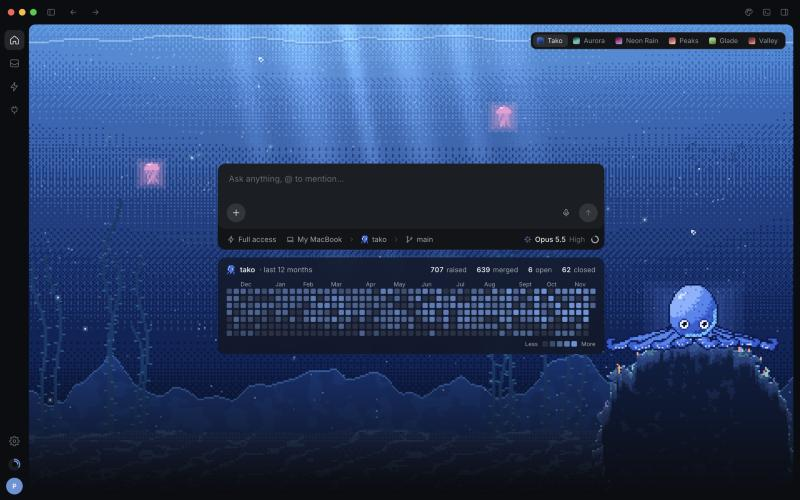
</p>
<p align="center"><sub><b>Home.</b> A living pixel-art scene behind the composer, and a year of your PRs as a heatmap.</sub></p>

<table>
  <tr>
    <td width="50%">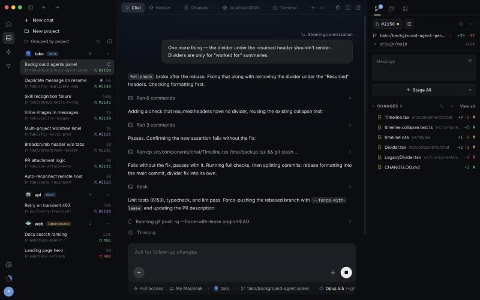<br><sub><b>Chats.</b> Every agent in its own worktree, with the changes beside it.</sub></td>
    <td width="50%">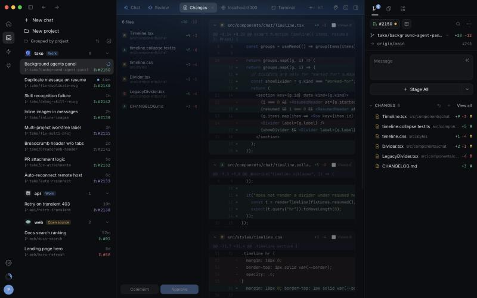<br><sub><b>Changes.</b> Review the diff without leaving the session.</sub></td>
  </tr>
  <tr>
    <td>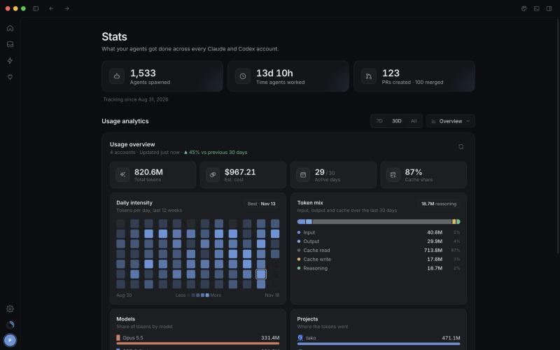<br><sub><b>Stats.</b> Agents spawned, hours worked, tokens and cost across every account.</sub></td>
    <td>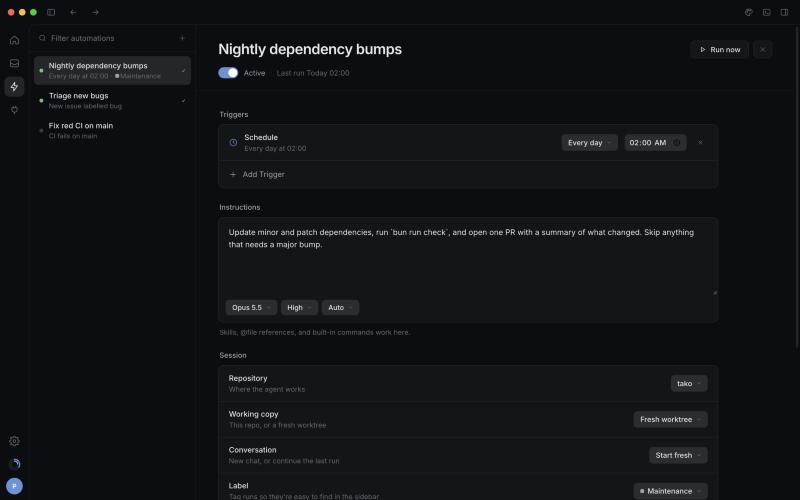<br><sub><b>Automations.</b> Put agents on a schedule: nightly bumps, triage, flaky-test hunts.</sub></td>
  </tr>
  <tr>
    <td>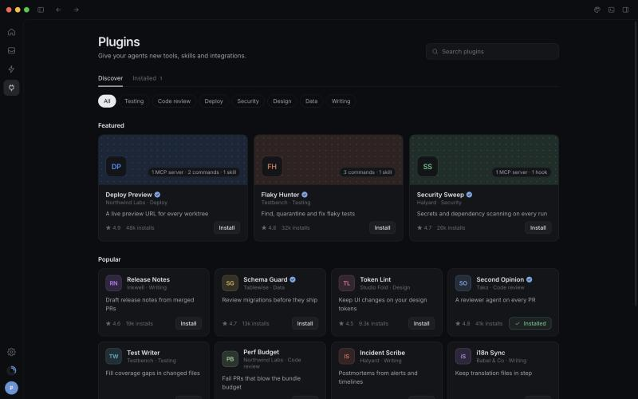<br><sub><b>Plugins.</b> Give your agents new tools, skills and integrations.</sub></td>
    <td>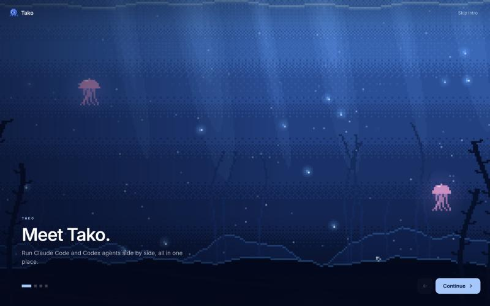<br><sub><b>Onboarding.</b> A short story to say hello on first launch.</sub></td>
  </tr>
</table>

<p align="center"></p>

## 

You spend more hours in your workspace than almost anywhere else. It should feel like a place you **want** to be.

Most dev tools are grey rectangles that stutter as they scroll, and AI tools feel like a chat box bolted onto a terminal. Tako starts from a different idea: **your workspace should be exciting and beautiful to work in.** When the screen feels alive, with tiny jellyfish drifting behind your prompt, a theme that matches your mood, and every animation landing at 120 frames a second, you notice the work, not the tool.

So Tako takes design seriously and doesn't fake speed:

- 🎨 **Beautiful by default.** Hand-made pixel-art scenes, eight themes, a type system with real hierarchy, and motion that is quick and never in your way.
- ⚡ **Fast for real.** Native Rust drawn straight on the GPU, with no browser engine underneath.
- 🧭 **Built for agents.** The point is parallel work: many agents, many branches, one calm place to watch, steer and ship them.

<p align="center"></p>

## 

<table>
  <tr>
    <td width="72" align="center"></td>
    <td><b>Agents side by side</b><br>Claude Code and Codex sessions in tabs, each with a smooth live feed, a "Thinking" shimmer, collapsible tool runs and mid-run <i>steering</i>.</td>
    <td width="72" align="center"></td>
    <td><b>A worktree per session</b><br>The sidebar groups sessions by project and label, shows branch and PR at a glance, and folds, multi-selects and reorders. <kbd>⌘↓</kbd> / <kbd>⌘↑</kbd> walks the worktrees.</td>
  </tr>
  <tr>
    <td align="center"></td>
    <td><b>Tool tabs in every session</b><br>Changes, Browser, Editor, Markdown, Whiteboard, Emulator and a <b>real terminal</b> (alacritty PTY on a GPU grid). <kbd>⌘T</kbd> opens the launcher; <kbd>⌘[</kbd> <kbd>⌘]</kbd> switch tabs, even while typing.</td>
    <td align="center"></td>
    <td><b>Source control, built in</b><br>A right-hand panel with the change list, line counts, Stage All, commit message and the branch's PR, so review never needs another window.</td>
  </tr>
  <tr>
    <td align="center"></td>
    <td><b>Home that's alive</b><br>Six animated pixel-art backdrops behind the composer, plus a 12-month heatmap of PRs raised, merged, open and closed.</td>
    <td align="center"></td>
    <td><b>Stats</b><br>Agents spawned, time worked, PRs shipped, tokens, estimated cost, cache share, token mix, models and projects, across every account.</td>
  </tr>
  <tr>
    <td align="center"></td>
    <td><b>Automations</b><br>Schedule agents with triggers, instructions, model and effort, a repo and a fresh worktree, then let them open the PR.</td>
    <td align="center"></td>
    <td><b>Plugins</b><br>A marketplace of tools, skills and integrations: deploy previews, flaky-test hunters, security sweeps, release notes and more.</td>
  </tr>
  <tr>
    <td align="center"></td>
    <td><b>Theme engine</b><br>Eight hand-tuned presets, or <b>Auto</b>, which derives the whole palette from the scene behind your composer. Dark and light.</td>
    <td align="center"></td>
    <td><b>Considerate by design</b><br>Honours macOS <i>Reduce motion</i>, remembers your layout, theme and scene between launches, and <kbd>Esc</kbd> always gets you out.</td>
  </tr>
</table>

<p align="center"></p>

## 

<p align="center">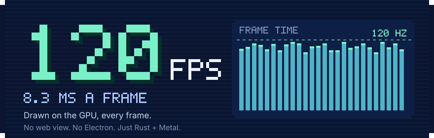</p>

Tako runs at **120 FPS** on ProMotion displays. Every pixel, from the text and the diff to the terminal grid and the ocean, is drawn by [GPUI](https://www.gpui.rs) on Metal. There's no DOM, no layout thrash and no web view hiding underneath.

- **Page transitions** cross-fade in about 250 ms with no empty frames. The composer glides between Home and Chats.
- **Scenes** are upscaled nearest-neighbour once on the CPU, then composited with a custom **additive-blend** sprite pipeline, so light rays, aurora and neon glows *add light* like they should.
- **See it yourself.** There's a built-in FPS counter in the bottom-right corner, and `TAKO_FRAMELOG=1` logs every frame slower than 9.5 ms.

<p align="center"></p>

## 

<p align="center">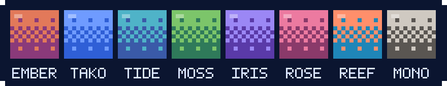</p>
<p align="center">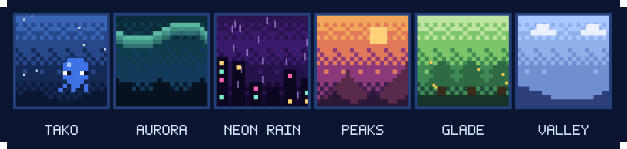</p>

Pick a scene, then pick a theme or let **Auto** read the colours straight out of the scene. Your whole workspace re-tints to match.

<p align="center"></p>

## 

```bash
git clone https://github.com/Prethish-Kumar/tako.git
cd tako
cargo run --release      # opens Tako at 1440×900
```

> [!NOTE]
> Tako targets **macOS** first: the additive-blend renderer is a patched Metal backend (`vendor/gpui-pre-apple`). Windows and Linux build with GPUI's wgpu renderer and fall back to normal blending.

| Shortcut | Does |
| --- | --- |
| <kbd>⌘T</kbd> | Open the launcher |
| <kbd>⌘[</kbd> / <kbd>⌘]</kbd> | Previous / next tab |
| <kbd>⌘↑</kbd> / <kbd>⌘↓</kbd> | Step through worktrees |
| <kbd>Esc</kbd> | Close menus, popovers and dialogs |

<p align="center"></p>

## 

| Layer | Choice |
| --- | --- |
| **Language** | Rust (2024 edition) |
| **UI** | [GPUI](https://www.gpui.rs) via `gpui-kit` 0.10 + gpui-component |
| **Renderer** | Metal, patched with an additive sprite pipeline |
| **Terminal** | `alacritty_terminal` PTY, drawn on a GPUI grid |
| **Scenes** | Procedural pixel art, Bayer-dithered, nearest-neighbour upscaled |
| **State** | `~/.config/tako/state.json` |

```
src/
├── app.rs          window chrome, rail, views, actions
├── chat.rs         agent feed, composer, steering
├── sidebar.rs      projects, labels, worktrees
├── right.rs        source control panel
├── tools/          browser, diff, terminal, editor, …
├── pages/          automations, plugins, settings, stats
├── scene/          tako, aurora, neon, peaks, glade, valley
├── overlays/       onboarding, theme, profile, usage
└── theme.rs        tokens + the theme engine
```

There's more in [`DEV.md`](DEV.md), which covers the architecture, GPUI idioms and the offscreen snapshot tool, and [`GAPS.md`](GAPS.md), which records every place the renderer needed a creative workaround.

<p align="center"></p>

<p align="center">
  
</p>
